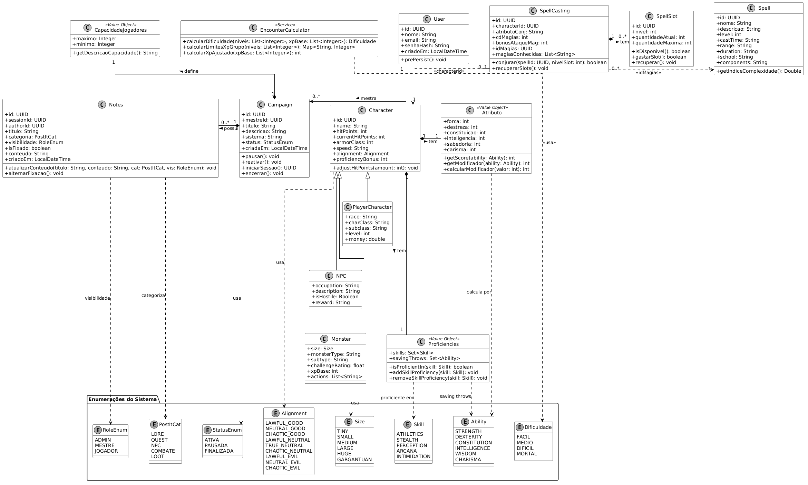
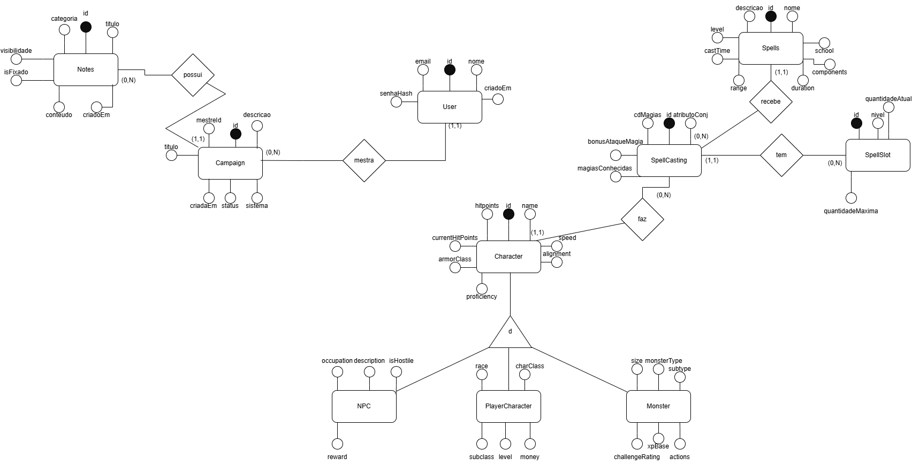

# 🛡️ ShieldNote RPG Box — Mobile

Aplicação móvel desenvolvida para a disciplina de **Programação para Dispositivos Móveis**, atuando como a interface cliente (*front-end*) do ecossistema **ShieldNote RPG Box** para gerenciamento de campanhas e sessões de RPG de mesa.

---

## 👥 Equipe

* **Vinícius**
* **Khauan**
* **João Victor**

---

## 🎯 Objetivo

Desenvolver uma aplicação móvel intuitiva, ágil e responsiva que consuma a API RESTful do **ShieldNote RPG Box**, permitindo que Mestres e Jogadores gerenciem campanhas, controlem o fluxo de sessões em tempo real, consultem grimórios de magias e calculem a dificuldade de encontros diretamente pelo smartphone, reduzindo a burocracia de cálculos e anotações manuais durante as partidas.

---

## 🎲 Público-Alvo

* **Mestres de RPG (Game Masters):** Usuários que necessitam organizar múltiplas campanhas (especialmente no sistema *Dungeons & Dragons 5ª Edição*), controlar a capacidade da mesa, gerenciar o estado da aventura e balancear combates rapidamente durante o jogo.
* **Jogadores de RPG de Mesa:** Usuários que buscam consultar informações das campanhas ativas, acompanhar sessões e visualizar detalhes técnicos e níveis de poder de suas magias de forma prática no celular.

---

## 📋 Requisitos do Sistema

### Requisitos Funcionais (RF)

| Código | Requisito | Descrição |
| :--- | :--- | :--- |
| **RF01** | **Gerenciamento de Campanhas** | Permitir criar, listar (com suporte a paginação e busca por título), visualizar detalhes e remover campanhas. |
| **RF02** | **Controle de Estado da Campanha** | Permitir ao Mestre alterar o ciclo de vida da campanha na interface (`ATIVA`, `PAUSADA` e `FINALIZADA`) e gerar o início de novas sessões. |
| **RF03** | **Configuração de Capacidade da Mesa** | Permitir definir e visualizar o limite mínimo e máximo de jogadores ao criar ou consultar uma campanha, exibindo a descrição formatada da capacidade. |
| **RF04** | **Catálogo e Grimório de Magias** | Exibir a listagem e os detalhes das magias cadastradas, apresentando indicadores visuais (barras de progresso/medidores) baseados no **Índice de Complexidade** da magia. |
| **RF05** | **Calculadora de Encontros** | Disponibilizar uma tela interativa para cálculo e simulação de nível de dificuldade de encontros/combates com base nos parâmetros da mesa. |
| **RF06** | **Validação de Formulários** | Validar os dados inseridos pelo usuário diretamente nos campos do aplicativo (ex: impedir máximo de jogadores menor que o mínimo ou campos obrigatórios vazios) antes do envio para a API. |

### Requisitos Não Funcionais (RNF)

* **RNF01 — Integração via API REST e HATEOAS:** O aplicativo deve se comunicar com o *back-end* (Spring Boot) via requisições HTTP/JSON, utilizando os links de hipermídia (HATEOAS) retornados pela API para habilitar ou desabilitar botões de ação dinamicamente conforme o estado da campanha.
* **RNF02 — Usabilidade em Mesa (*Mobile-First*):** A interface deve priorizar baixa carga cognitiva, navegação fluida com uma mão e paleta de cores confortável (tema escuro/imersivo) para uso prolongado durante sessões presenciais ou remotas.
* **RNF03 — Tratamento de Erros e Estados de Tela:** A aplicação deve apresentar *feedbacks* visuais claros para estados de carregamento (*skeletons/spinners*), listas vazias (*empty states*) e tratamento amigável para respostas de erro HTTP (`400 Bad Request`, `404 Not Found` e falhas de conexão).
* **RNF04 — Desempenho:** Aproveitamento das respostas rápidas das rotas cacheadas do *back-end* e gerenciamento eficiente de estado local no dispositivo para evitar reconstruções desnecessárias de tela.

---

## 📐 Diagramas

### Diagrama de Classes

### Diagrama Entidade-Relacionamento (DER)

---

## 🛠️ Organização da Equipe para Desenvolvimento

### Divisão de Responsabilidades

| Integrante | Foco Principal | Atribuições no Projeto |
| :--- | :--- | :--- |
| **Vinícius** | **Arquitetura Mobile, Integração com API & Estado** | Configuração da camada de rede (consumo REST/HTTP), mapeamento de modelos/DTOs, gerenciamento de estado das telas, tratamento de erros da API e integração do módulo de Campanhas. |
| **Khauan** | **UI/UX, Componentização & Fluxo de Magias** | Criação do *Design System* (temas, tipografia, componentes reutilizáveis, *cards*), prototipação e desenvolvimento das telas de Grimório de Magias e indicadores visuais de complexidade. |
| **João Victor** | **Telas de Domínio, Navegação & Calculadora** | Estruturação das rotas de navegação do app, validação de formulários de entrada, desenvolvimento de demais módulos e  controle de sessões e testes de usabilidade. |

*(Todos os integrantes participam de forma colaborativa na revisão de código e nos testes de integração entre o aplicativo e a API).*
